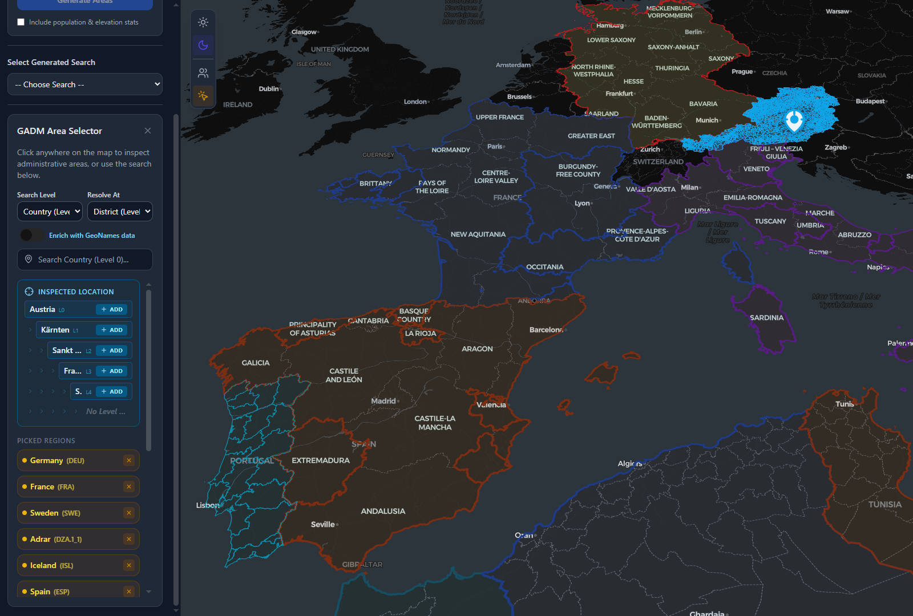

# @polymech/gadm

 


**[Homepage](https://service.polymech.info/)** &nbsp;&middot;&nbsp; **[Source Code](https://git.polymech.info/polymech/gadm-ts)**

Pure TypeScript interface to the [GADM](https://gadm.org) v4.1 administrative boundaries database.  
Zero Python dependencies — parquet data, tree construction, iterators, and caching all run in Node.js.

## Overview

| Feature | Description |
|---------|-------------|
| **Database** | 356K rows from GADM 4.1, stored as a 6 MB Parquet file |
| **Admin Levels** | L0 (country) → L5 (municipality/commune) |
| **Tree API** | Build hierarchical trees, walk with DFS/BFS/level iterators |
| **Name Search** | Fuzzy search across all levels with Levenshtein suggestions |
| **GeoJSON** | Cached / GeoPackage boundaries with optional GHS enrichment |
| **Map paint** | `prepareBoundaryForMap` / C++ `--display-clean` — holes, islands, coast spikes |
| **Caching** | File-based JSON cache for trees and boundary FeatureCollections |
| **VARNAME** | Alternate names / English translations via `VARNAME_1..5` columns |
| **C++ batch** | `boundaries.exe` — Ninja + MSVC scripts, GDAL/GEOS bake (see `cpp/README.md`) |




---

## Installation

```bash
npm install @polymech/gadm
```

Internal monorepo — referenced via workspace protocol in `package.json`.

---

## Acknowledgments & PyGADM Port

This package is a direct Node.js/TypeScript port of the excellent Python library [pygadm](https://github.com/gee-community/pygadm) (which powers the core parquet-based data structure and fetching methodology). 

While bringing these capabilities natively to the javascript ecosystem, we built and added several critical enhancements designed specifically for web applications and browser performance:

- **Resolution bake (TS + C++):** `@turf/simplify` / GEOS topology-preserving simplify with a configurable `resolution` parameter (1=full detail, 10=max, default ~3–4). Compresses raw unoptimized country polygons and rounds coordinates (geometry + GHS metadata) to 5 decimal places.
- **Map-paint display clean:** `prepareBoundaryForMap` / C++ `--display-clean` strip lake holes, drop outer islands under ~5 km min bbox width (always keep the largest part), and remove coastline V-spikes / harbour ears. Stamps `_mapPaint: true` so clients can skip reprocessing.
- **Unified Cascading Caches:** Intelligent caching ladders that auto-resolve across global `process.env.GADM_CACHE`, active `process.cwd()`, and local workspace `../cache` mounts.
- **Target-Level Subdivision Extraction:** A unified `targetLevel` API design that distinctly differentiates between extracting an outer merged geographic perimeter vs. an array of granular inner subdivided states natively derived from recursive `.merge()` operations.
- **Smart Pre-cacher Scripts:** `boundaries.ts` (TS) and `boundaries.exe` (C++) auto-resume batch builds for levels 0–5; `smooth-coast-cache` rewrites existing JSON for map paint without a full GeoPackage rebuild.

---

## Quick Start

```ts
import { buildTree, walkDFS, findNode, searchRegions, getNames } from '@polymech/gadm';

// Build a tree for Spain
const tree = await buildTree({ admin: 'ESP', cacheDir: './cache/gadm' });
console.log(tree.root.children.length); // 18 (comunidades)

// Find a specific region
const bcn = findNode(tree.root, 'Barcelona');
console.log(bcn?.gid); // ESP.6.1_1

// Walk all nodes
for (const node of walkDFS(tree.root)) {
    console.log('  '.repeat(node.level) + node.name);
}

// Search via wrapper API
const result = await searchRegions({ query: 'France', contentLevel: 2 });
console.log(result.data?.length); // ~101 departments
```

---

## API Reference

### Tree Module

#### `buildTree(opts: BuildTreeOptions): Promise<GADMTree>`

Builds a hierarchical tree from the flat parquet data. Results are cached to disk when `cacheDir` is set.

```ts
interface BuildTreeOptions {
    name?: string;      // Region name: "Spain", "Cataluña", "Bayern"
    admin?: string;     // GADM code: "ESP", "DEU.2_1", "FRA.11_1"
    cacheDir?: string;  // Path for JSON cache files (optional)
}
```

Either `name` or `admin` must be set (not both).  
Throws if the region is not found in the database.

#### `GADMTree` and `GADMNode`

```ts
interface GADMTree {
    root: GADMNode;     // Root node of the tree
    maxLevel: number;   // Deepest admin level reached (0–5)
    nodeCount: number;  // Total nodes across all levels
}

interface GADMNode {
    name: string;           // Display name: "Barcelona"
    gid: string;            // GADM ID: "ESP.6.1_1"
    level: number;          // Admin level 0–5
    children: GADMNode[];   // Sub-regions (sorted alphabetically)
}
```

#### Iterators

All iterators are generators — use `for...of` or spread into arrays.

| Function | Description |
|----------|-------------|
| `walkDFS(node)` | Depth-first traversal, top-down |
| `walkBFS(node)` | Breadth-first, level by level |
| `walkLevel(node, level)` | Only nodes at a specific admin level |
| `leaves(node)` | Only leaf nodes (deepest, no children) |
| `findNode(root, query)` | First DFS match by name or GID (case-insensitive) |

```ts
// Get all provinces (level 2) under Cataluña
const provinces = [...walkLevel(tree.root, 2)];
// → [{ name: 'Barcelona', ... }, { name: 'Girona', ... }, ...]

// Count municipalities
const municipios = [...leaves(tree.root)];
console.log(municipios.length); // 955

// Find by GID
const girona = findNode(tree.root, 'ESP.6.2_1');
```

---

### Names Module

#### `getNames(opts: NamesOptions): Promise<NamesResult>`

Searches the parquet database for admin areas. Returns deduplicated rows with fuzzy match suggestions on miss.

```ts
interface NamesOptions {
    name?: string;          // Search by name
    admin?: string;         // Search by GADM code
    contentLevel?: number;  // Target level (0–5), -1 = auto
    complete?: boolean;     // Return all columns up to contentLevel
}

interface NamesResult {
    rows: GadmRow[];    // Matched records
    level: number;      // Resolved content level
    columns: string[];  // Column names in result
}
```

On miss, throws with Levenshtein-based suggestions:
```
The requested "Franec" is not part of GADM.
The closest matches are: France, Franca, Franco, ...
```

---

### Items Module

#### `getItems(opts: ItemsOptions): Promise<GeoJSONCollection>`

Fetches GeoJSON boundaries from the GADM CDN, with name correction from the local parquet database (workaround for camelCase bug in GADM GeoJSON responses).

```ts
interface ItemsOptions {
    name?: string | string[];   // Region name(s)
    admin?: string | string[];  // GADM code(s)
    contentLevel?: number;      // Target level, -1 = auto
    includeOuter?: boolean;     // Also include the containing region's external perimeter
    geojson?: boolean;          // Return geometries instead of just properties (metadata)
}
```

Supports continent expansion: `getItems({ name: ['europe'] })` fetches all European countries.

---

### Wrapper Module (Server API)

Higher-level API designed for HTTP handlers. Includes file-based caching via `GADM_CACHE` env var (default: `./cache/gadm`).

| Function | Description |
|----------|-------------|
| `searchRegions(opts)` | Search by name, returns metadata or GeoJSON |
| `getBoundary(gadmId, contentLevel?, cache?, enrichOpts?, resolution?)` | Get GeoJSON boundary for a GADM ID |
| `getRegionNames(opts)` | List sub-region names with depth control |

#### Integration Example (Server API)

Here is a real-world example of wrapping the GADM engine inside an HTTP handler (like Hono or Express) to fetch dynamically chunked boundaries and enrich their GeoJSON metadata on the fly:

```ts
import { getBoundary } from '@polymech/gadm';
import * as turf from '@turf/turf';

async function handleGetRegionBoundary(c) {
    const id = c.req.param('id'); // e.g. "DEU" or "ESP.6_1"
    const targetLevel = c.req.query('targetLevel'); // e.g. "1" for inner states 
    const enrich = c.req.query('enrich') === 'true';

    try {
        const parsedTargetLevel = targetLevel !== undefined ? parseInt(targetLevel) : undefined;
        
        // Instantly fetches Boundary FeatureCollection (already cached and compressed)
        const result = await getBoundary(id, parsedTargetLevel);

        if ('error' in result) {
            return c.json({ error: result.error }, 404);
        }

        // On-the-fly Geometry Enrichment
        if (enrich && result.features) {
            for (const feature of result.features) {
                // Calculate geographical square kilometers organically using Turf
                const areaSqkm = Math.round(turf.area(feature as any) / 1000000);
                feature.properties.areaSqkm = areaSqkm;
                
                // Construct bounding box for client camera tracking
                const bbox = turf.bbox(feature as any);
                feature.properties.bbox = bbox;
            }
        }

        return c.json(result, 200);

    } catch (error) {
        return c.json({ error: error.message }, 500);
    }
}
```

---

## Data Enrichment (Optional GeoTIFFs)

The GADM engine includes built-in optional enrichers that can rapidly query **European Commission GHSL (Global Human Settlement Layer)** GeoTIFFs directly in Node.js to instantly yield the **exact simulated population** and **built-up concrete metric weight** perfectly inside any requested boundary. 

Because `getBoundary()` natively projects bounding boxes to Mollweide `EPSG:54009` and extracts spatial windows from the raw satellite TIFF data, you get perfect 100m² resolution density analytics on the fly, saving you from setting up heavy PostGIS/QGIS servers.

### Prerequisites (GHSL Data)
You must download the raw GeoTIFF datasets from the EU JRC Open Data portal and store them locally (e.g. in `data/ghs/`). *Warning: These files are >1GB.*

| Dataset | Metric | URL |
|---------|--------|-----|
| `GHS_POP` | Population (2030 Projections) | [GHS_POP_E2030_GLOBE_R2023A_54009_100_V1_0.tif](https://jeodpp.jrc.ec.europa.eu/ftp/jrc-opendata/GHSL/GHS_POP_GLOBE_R2023A/GHS_POP_E2030_GLOBE_R2023A_54009_100/V1-0/GHS_POP_E2030_GLOBE_R2023A_54009_100_V1_0.zip) |
| `GHS_BUILT_S`| Built-up Area / Concrete Surface | [GHS_BUILT_S_E2030_GLOBE_R2023A_54009_100_V1_0.tif](https://jeodpp.jrc.ec.europa.eu/ftp/jrc-opendata/GHSL/GHS_BUILT_S_GLOBE_R2023A/GHS_BUILT_S_E2030_GLOBE_R2023A_54009_100/V1-0/GHS_BUILT_S_E2030_GLOBE_R2023A_54009_100_V1_0.zip) |

### Option 1: Native Wrapper Option (Recommended)

Simply pass `{ pop: true, built: true }` into `getBoundary()`. It will automatically discover the `.tif` datasets (looking in `data/ghs`, `cache/ghs`, and environment variables), scan the density per feature, calculate the true Population and Physical Centers of Mass, and append them directly to the GeoJSON `feature.properties` (deep cloning and caching the result!)

```typescript
const result = await getBoundary(gadmId, targetLevel, undefined, {
    pop: true,
    built: true
});

// result.features[0].properties will now contain:
// {
//   ...
//   "population": 5666,               <- the standard property overwritten with hyper-accurate bounds
//   "ghsPopMaxDensity": 125,          <- highest density 100x100m block
//   "ghsPopCenter": [2.1019, 41.8130], <- true center of mass (where residents actually live vs geographical center)
//   "ghsPopCenters": [                <- up to 5 distinct population clusters [lon, lat, max_density] 
//      [2.1019, 41.8130, 125]         
//   ],
//   "ghsBuiltWeight": 744080,         <- concrete physical size index
//   "ghsBuiltCenter": [2.1039, 41.8130], <- true center of concrete (industrial + urban spread)
//   "ghsBuiltCenters": [              <- up to 5 distinct concrete clusters [lon, lat, max_density]
//      [2.1039, 41.8130, 300]         
//   ]
// }
```

### Option 2: Standalone Feature Module

If you already have arbitrary GeoJSON polygons, you can extract the exact same density metrics natively:

```typescript
import { enrichFeatureWithGHS } from '@polymech/gadm';

const myCustomPolygon = { type: 'Feature', geometry: { ... } };

const stats = await enrichFeatureWithGHS(myCustomPolygon, {
    pop: true
});

console.log(stats.ghsPopulation, stats.ghsPopCenter);
```

---

## Boundary Geometries & Caching

Fetching complex geospatial polygons (like country borders or district subdivisions) requires merging and calculating hundreds of complex geometries. Doing this mathematically at runtime for a user request is too slow, so `@polymech/gadm` handles this with pre-compiled caches and aggressive size compression.

### Resolving Boundary Target Levels

When building interactive user interfaces or fetching boundaries through the top-level API (`handleGetRegionBoundary`), the returned `FeatureCollection` granularity is controlled strictly through the `targetLevel` (or programmatic `contentLevel`).

- **Outer Boundary**: Set `targetLevel` exactly equal to the region's intrinsic level (e.g., Targetting `Level 0` for Spain). The engine uses `turf` to automatically dissolve internal geometries, returning a single merged bounding polygon mimicking the total region envelope.
- **Inner Subdivisions**: Provide a `targetLevel` deeper than the intrinsic level (e.g., Targetting `Level 1` for Spain). The engine filters for the exact constituent parts and returns a `FeatureCollection` where each active sub-group (the 17 Spanish States) is a distinctly preserved geometry feature.

### Geometry Simplification & Resolution

Both the TypeScript and C++ **batch** pipelines apply Douglas–Peucker–style simplification controlled by a `resolution` parameter (C++ default: **3** ≈ 200 m; TS wrapper historically defaulted to **4**):

| Resolution | Tolerance (approx.) | Coordinate Precision | Use Case |
|------------|---------------------|----------------------|----------|
| 1 | 0 (full) | 5 decimals | Maximum detail |
| 3 | 0.002 (~200 m) | 5 decimals | C++ default — good map bake |
| 4 | 0.005 (~500 m) | 5 decimals | Stronger compression |
| 10 | 0.5 | 5 decimals | Maximum compression |

GHS metadata coordinates (`ghsPopCenter`, `ghsBuiltCenters`, etc.) are also rounded to 5 decimal places to match geometry precision.

### Map-paint display clean (TS + C++)

Resolution bake alone still leaves lake **holes**, tiny **outer islands**, and coastline **V-spikes**. For MapLibre strokes / hover outlines, run the display pipeline (same rules in TS and C++):

| Step | Default | Effect |
|------|---------|--------|
| Strip interior rings | on | GADM lakes stop drawing as dense line holes |
| Drop small outer islands | min width **5 km** | Keep largest part always (Monaco still paints) |
| Coast spike / ear filter | on | Remove short-leg V-cuts and harbour ears; long fjords kept |

```ts
import {
    prepareBoundaryForMap,
    simplifyBoundaryForMap, // alias
    stripInteriorRings,
    dropSmallOuterIslands,
    smoothCoastRing,
    MIN_OUTER_ISLAND_WIDTH_KM,
} from '@polymech/gadm';

const forMap = prepareBoundaryForMap(fc, { minOuterWidthKm: 5 });
// forMap._mapPaint === true  → client can skip reprocessing
```

HTTP / Places API: `GET /api/regions/boundary/:id?simplify=map` applies the same pass server-side.

**Rebake existing cache JSON (TS, in place):**

```bash
npm run smooth-coast-cache:l01          # levels 0,1
npx tsx scripts/smooth-coast-cache.ts --levels=0 --country=ESP --min-outer-km=5
```

**Bake from GeoPackage (C++, recommended for L0):**

```bash
# After npm run build:cpp — skip GHS rasters for speed / ATA stability
.\dist\win-x64\boundaries.exe --country=all --level=0 --display-clean --min-outer-km=5 --force `
  --cache-dir=cache/gadm --gpkg=data/gadm_410.gpkg `
  --pop-tiff=__none__.tif --built-tiff=__none__.tif --resolution=3
```

> **Note:** GHS enrich on Antarctica (`ATA`) can access-violate in the current GDAL path. Pass nonexistent TIFF paths (as above) for geometry-only display regenerations. See [cpp/README.md](./cpp/README.md).

### Smart Caching & Cache Resolution Order

To ensure instantaneous delivery (sub-10ms) of these polygons to your HTTP APIs:

1. **Pre-Caching Scripts**: Run `npm run boundaries -- --country=all` (TypeScript) or `npm run boundaries:cpp` / `boundaries.exe` (C++). Both iterate downwards to compute and compress hierarchical layers 0 through 5 for each country. Existing files are skipped for easy resume unless `--force`.
2. **Cascading Cache Lookups**: The package resolves caches in order:
   - Exact sub-region cache file: `boundary_{gadmId}_{level}.json`
   - Full country cache file: `boundary_{countryCode}_{level}.json` (prefix-filtered for sub-region queries)
   - Environment paths: `process.env.GADM_CACHE`, then `process.cwd()/cache/gadm`, then `../cache/gadm`
   - Live GeoPackage query (fallback)
3. **Payload compression**: Resolution bake + optional `--display-clean` / `prepareBoundaryForMap` keep MapLibre payloads small. Display-cleaned FeatureCollections include `_mapPaint: true`.

### C++ build (Windows)

Same MSVC + Ninja injection pattern as pixlwiz. From `packages/gadm`:

```bash
npm run configure:cpp    # cmake --preset release (vs-env + ensure-vcpkg)
npm run build:cpp        # configure + ninja boundaries
npm run build:cpp:fast   # ninja only
```

Default preset reuses `./cpp/vcpkg_installed` (`VCPKG_MANIFEST_INSTALL=OFF`). Full docs: [cpp/README.md](./cpp/README.md).

---

### Database Module (Low-Level)

| Function | Description |
|----------|-------------|
| `loadDatabase()` | Load parquet into memory (lazy, singleton) |
| `getColumns()` | Return column names |
| `resetCache()` | Clear the in-memory row cache |

`GadmRow` is `Record<string, string>` — all values normalized to strings.

---

## Types

All types are exported from the package entry point:

```ts
import type {
    GADMNode, GADMTree, BuildTreeOptions,     // tree
    NamesOptions, NamesResult, GadmRow,       // names + database
    ItemsOptions, GeoJSONFeature, GeoJSONCollection,  // items
    SearchRegionsOptions, SearchRegionsResult, RegionNamesOptions,  // wrapper
    MapSimplifyOpts, CoastSmoothOpts,         // map-paint display clean
} from '@polymech/gadm';
```

---

## Data Layout

### Parquet File

`data/gadm_database.parquet` — **356,508 rows**, **6.29 MB**

| Column Group | Columns | Description |
|--------------|---------|-------------|
| GID | `GID_0` … `GID_5` | GADM identifiers per level |
| NAME | `NAME_0` … `NAME_5` | Display names per level |
| VARNAME | `VARNAME_1` … `VARNAME_5` | Alternate names / translations |

129,448 rows have `VARNAME_1` values (e.g. `Badakhshān`, `Bavière`).

### GADM Levels

| Level | Typical Meaning | Example (Spain) |
|-------|----------------|-----------------|
| 0 | Country | Spain |
| 1 | State / Region | Cataluña |
| 2 | Province / Department | Barcelona |
| 3 | District / Comarca | Baix Llobregat |
| 4 | Municipality | Castelldefels |
| 5 | Sub-municipality | *(rare, not all countries)* |

> **Note:** GADM does not include neighborhood/Stadtteil-level data.  
> For sub-city resolution (e.g. Johannstadt in Dresden), OSM/Nominatim would be needed.

---

## Caching

### Tree Cache (`cacheDir`)

When `cacheDir` is passed to `buildTree()`, the full tree is saved as `tree_{md5}.json`.  
Subsequent calls with the same `name`/`admin` return the cached tree instantly (~1ms).

### Wrapper Cache (`GADM_CACHE`)

The wrapper module caches search results, boundaries, and region names in `$GADM_CACHE/` (default `./cache/gadm`).  
Files are keyed by MD5 hash of the query parameters.

### In-Memory Cache

`loadDatabase()` is a singleton — the 356K-row array is loaded once per process.  
Call `resetCache()` to force a reload (useful in tests).

### Precalculating Boundaries

To improve runtime performance (especially for large geographies which take time to dissolve), you can precalculate and cache standard admin boundaries using the included CLI script:

```bash
cd packages/gadm

# Precalculate the outer boundary for a specific country
npm run boundaries -- --country=DEU

# Precalculate inner boundaries for a specific level
npm run boundaries -- --country=DEU --level=1

# Precalculate the outer boundary for ALL countries worldwide
npm run boundaries -- --country=all
```

Precalculated boundaries are saved as native `.json` artifacts inside the configured cache directory (`./cache/gadm/boundary_{CODE}_{LEVEL}.json`).

### C++ Native Pipeline (Recommended for Batch)

For full batch generation across all 263 countries × 6 levels, the native C++ port provides significantly faster processing using GDAL/GEOS/PROJ directly. It reads the same GeoPackage, performs geometry unions via WKB-precision GEOS, and enriches with GHS raster data — producing identical output to the TypeScript pipeline.

```bash
# Build (requires vcpkg + CMake)
npm run build:cpp                              # or: cmake --build cpp/build --config Release

# Run via npm scripts
npm run boundaries:cpp                         # all countries
npm run boundaries:cpp -- --country=DEU        # single country

# Sub-region splitting (generates boundary_ESP.6_1_4.json etc.)
npm run boundaries:cpp -- --country=all --level=4 --split-levels=1

# Custom resolution (1-10, default=4)
npm run boundaries:cpp -- --country=DEU --resolution=6
```

Output includes GHS enrichment by default when tiff files are present in `data/ghs/`:
- `ghsPopulation`, `ghsPopMaxDensity`, `ghsPopCenter`, `ghsPopCenters`
- `ghsBuiltWeight`, `ghsBuiltMax`, `ghsBuiltCenter`, `ghsBuiltCenters`

See [`cpp/README.md`](./cpp/README.md) for build prerequisites, full CLI reference, and architecture details.

---

## Data Refresh

Regenerate `data/gadm_database.parquet` from a GADM GeoPackage source file.

### Prerequisites

Download one of the core GeoPackage database files. You can point the package to your `gpkg` location using the `GADM_GPKG_PATH` environment variable, or store it in your working directory at `cache/gadm/gadm_410.gpkg`:

```bash
https://geodata.ucdavis.edu/gadm/gadm4.1/gadm_410-gpkg.zip  → unzip → gadm_410.gpkg
https://geodata.ucdavis.edu/gadm/gadm4.1/gadm_410-raw.gpkg
```

### Run

```bash
cd packages/gadm
npm run refresh
```

The script (`scripts/refresh-database.ts`):
1. Opens the GeoPackage (SQLite) via `better-sqlite3`
2. Auto-detects table format (per-level `ADM_x` tables or single flat table)
3. Extracts GID, NAME, and VARNAME columns for levels 0–5
4. Writes to `data/gadm_database.parquet` via `hyparquet-writer`

### Dev Dependencies (refresh only)

| Package | Purpose |
|---------|---------|
| `better-sqlite3` | Read GeoPackage (SQLite) files |
| `hyparquet-writer` | Write Parquet output |

These are `devDependencies` — not needed at runtime.

---

## Tests

```bash
cd packages/gadm
npx vitest run                              # all tests
npx vitest run src/__tests__/tree.test.ts   # tree tests only
```

### Tree Tests

JSON outputs saved to `tests/tree/` for inspection:

| File | Content |
|------|---------|
| `test-cataluna.json` | Full Cataluña tree (1,000 nodes, 955 leaves) |
| `test-germany-summary.json` | Germany L1 summary (16 Bundesländer, 16,402 nodes) |
| `test-dresden.json` | Sachsen → Dresden subtree with all children |
| `test-iterators.json` | DFS/BFS/walkLevel/findNode verification data |

### Name Tests

`src/__tests__/province-names.test.ts` — tests `getNames()` for France departments, exact matches, fuzzy suggestions.

---

## Architecture

```
packages/gadm/
├── cpp/                          # C++ native pipeline (GDAL/GEOS/PROJ)
│   ├── src/                      # main.cpp, gpkg_reader, geo_merge, ghs_enrich
│   ├── CMakeLists.txt
│   └── vcpkg.json
├── data/
│   ├── gadm_database.parquet     # 356K rows, 6.29 MB
│   ├── gadm_continent.json       # Continent → ISO3 mapping
│   └── ghs/                      # GHS GeoTIFF rasters (optional)
├── dist/
│   └── win-x64/                  # Compiled C++ binary + DLLs
├── scripts/
│   └── refresh-database.ts       # GeoPackage → Parquet converter
├── src/
│   ├── database.ts               # Parquet reader (hyparquet)
│   ├── names.ts                  # Name/code lookup + fuzzy match
│   ├── items.ts                  # GeoJSON boundaries from CDN
│   ├── gpkg-reader.ts            # GeoPackage boundary reader + C++ cache fallback
│   ├── enrich-ghs.ts             # GHS GeoTIFF enrichment (TS)
│   ├── wrapper.ts                # Server-facing API with cache
│   ├── tree.ts                   # Tree builder + iterators
│   ├── index.ts                  # Barrel exports
│   └── __tests__/
│       ├── tree.test.ts          # Tree building + iterator tests
│       └── province-names.test.ts
├── tests/
│   ├── tree/                     # Test output JSONs
│   └── cache/gadm/               # Tree cache files
└── package.json
```

## Dependencies

| Package | Type | Purpose |
|---------|------|---------|
| `hyparquet` | runtime | Read Parquet files (zero native deps) |
| `zod` | runtime | Schema validation |
| `better-sqlite3` | dev | GeoPackage reader (refresh only) |
| `hyparquet-writer` | dev | Parquet writer (refresh only) |
| `vitest` | dev | Test runner |
| `typescript` | dev | Build |

## Data

- [Pre populated cache - all countries](https://git.polymech.info/Pooly-Press/geo-cache.git) (--country=all --split-levels=0,1,2,3,4,5 --resolution=3")